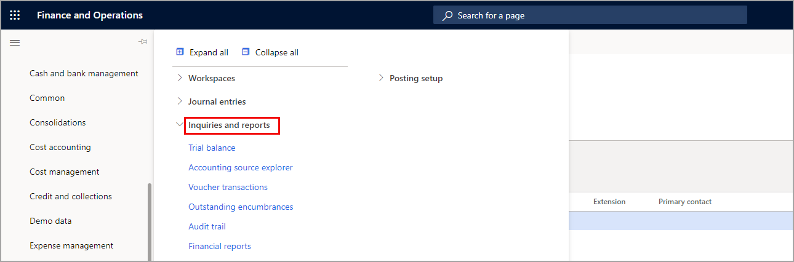

<!-- https://learn.microsoft.com/en-us/training/modules/work-analytics-reporting-finance-operations/4-find-inquiries-reports -->
# Find inquiries and reports

Completed

* 2 minutes

Modules like Supply Chain Management, Human Resources, and Finance, provide a comprehensive set of out-of-the-box reports and inquiries designed to enhance business decision-making. Each module typically includes a dedicated **Inquiries and Reports** menu, offering predefined tools and templates for quickly accessing, viewing, and analyzing data. Users can explore detailed transactional records, summary data, and system-generated analytics without requiring advanced technical expertise.

The following screenshot is an example of the **General ledger > Inquiries and Reports** menu item.

